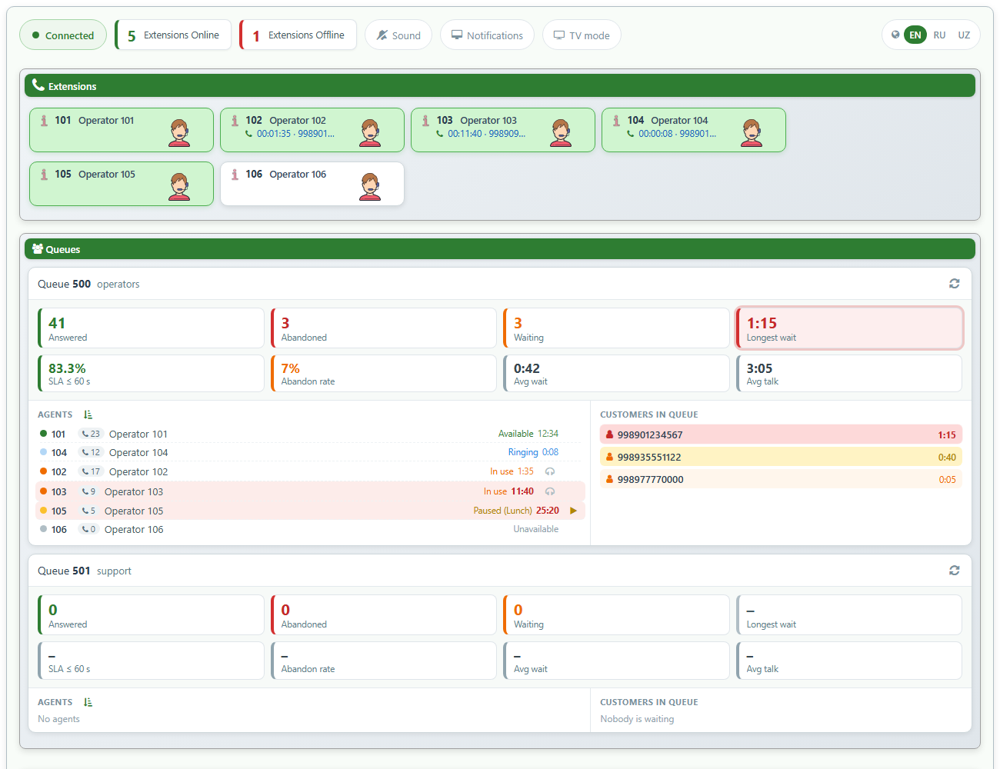
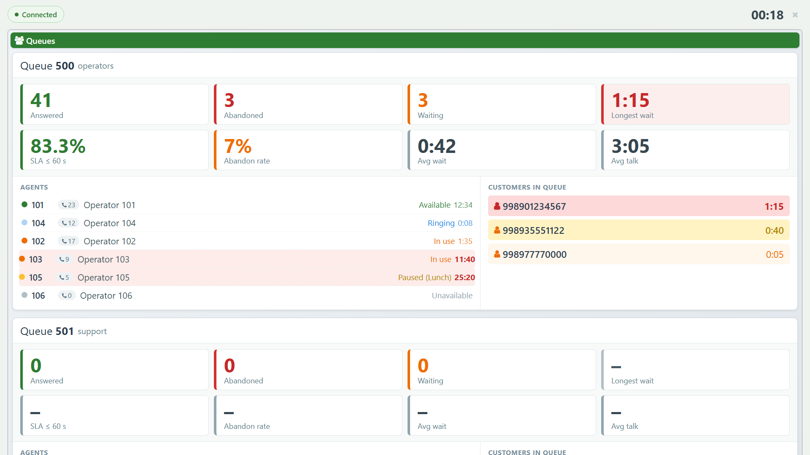
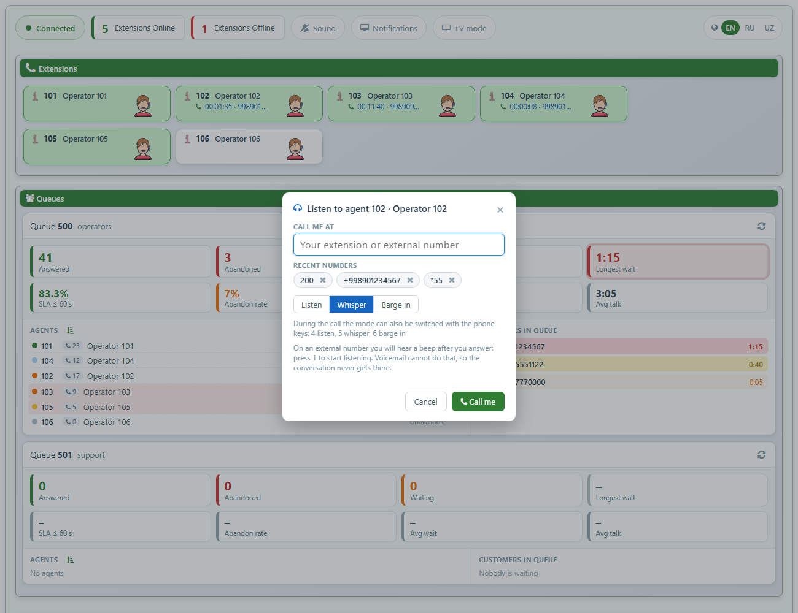
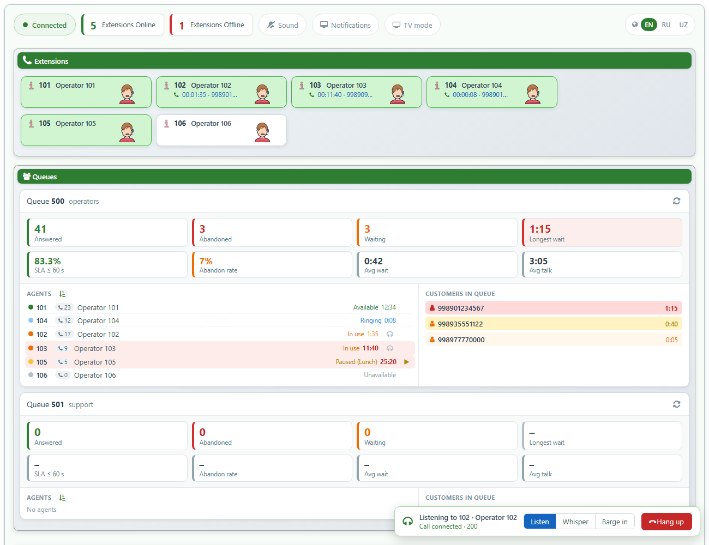

# Issabel Call Monitoring

**English** | [Русский](README.ru.md) | [Oʻzbekcha](README.uz.md)

A real-time call monitoring panel for **Issabel 5**. It replaces the Operator
Panel that was removed from Issabel 5 and is built for supervisors of small call
centers: extensions and their calls, queues with agents and waiting customers,
queue KPIs, long-wait alarms and call listening, on one page.



## Features

- **Extensions**: online / offline state, active calls with talk time and the
  other party.
- **Queue KPIs**: answered, abandoned, waiting, longest wait, service level
  (SLA), abandon rate, average wait and talk time. Colors show when a value
  needs attention.
- **Agents**: state, calls taken and time in the current state. Agents are
  sorted by state (free first) and highlighted after a long pause or a long
  call. The supervisor can pause or unpause an agent from the list.
- **Long-wait alarm**: waiting customers turn yellow and then red. The browser
  tab shows the number of waiting customers. An optional beep and desktop
  notification fire when someone waits too long.
- **TV mode**: a full-screen view for a TV in the call center room: queues
  only, large numbers, no buttons.
- **Call listening**: listen to an agent's call, whisper to the agent or barge
  in. Asterisk calls you at your own extension or an external number.
- **English, Russian and Uzbek** interface. The module follows the Issabel
  language setting; the EN / RU / UZ buttons in the status bar switch it for
  the current browser.

## Requirements

- Issabel 5 (FreePBX-based), with root access over SSH.
- A browser with JavaScript. Desktop notifications additionally need the page
  to be opened over HTTPS.

## Installation

On the PBX, as root:

```sh
git clone https://github.com/a-abdurazzoq/issabel-call-monitoring.git
cd issabel-call-monitoring
bash install.sh
```

Then open **PBX → Call Monitoring** in Issabel.

The installer copies the module to `/var/www/html/modules/control_panel/`,
adds the menu item and sets the owner to `asterisk:asterisk`. For listening on
an external number it also installs a small dialplan
(`/etc/asterisk/extensions_cp_spy.conf`, included from
`extensions_custom.conf`) and reloads the dialplan. By default only
the *administrator* group can see the menu item. Other groups can be given
access in Issabel's group permissions.

### Updating

```sh
cd issabel-call-monitoring
git pull
bash install.sh
```

The panel layout (which extension is shown in which area) is stored in
`/var/www/db/control_panel_design.db`. The installer does not touch that file,
so an update keeps it. After an update, reload the page with **Ctrl+F5** so
that the browser loads the new scripts.

### Uninstalling

```sh
rm -rf /var/www/html/modules/control_panel
issabel-menuremove control_panel
rm -f /etc/asterisk/extensions_cp_spy.conf
sed -i '/^#include extensions_cp_spy.conf$/d' /etc/asterisk/extensions_custom.conf
asterisk -rx "dialplan reload"
```

## Using the panel

### Status bar

| Element | Meaning |
| --- | --- |
| Connected / Connecting… | Whether the last request to the PBX succeeded |
| Extensions Online / Offline | Registered and unregistered extensions |
| Sound | Beep when a customer waits longer than the alarm time. Browsers allow sound only after a click, so turn it on once with this button. The choice is remembered. |
| Notifications | Desktop notification for a long wait while the page is in the background. Shown only on HTTPS. |
| TV mode | Full-screen view for a TV, see [TV mode](#tv-mode). |
| EN / RU / UZ | Module language for this browser (a cookie). Without a choice the Issabel language is used, or English if Issabel uses a language the module doesn't have. |

### Queue card

| Tile | Meaning | Colors |
| --- | --- | --- |
| Answered / Abandoned | Calls answered by agents / calls the customer hung up before an answer | |
| Waiting | Customers in the queue right now | |
| Longest wait | Wait time of the customer waiting longest | yellow ≥ 30 s, red ≥ 60 s |
| SLA ≤ N s | Share of calls answered within the queue's *Service Level* time | green ≥ 80 %, yellow ≥ 60 %, red below |
| Abandon rate | Abandoned / (answered + abandoned) | green ≤ 5 %, yellow ≤ 15 %, red above |
| Avg wait / Avg talk | Asterisk's running averages | |

These values come from Asterisk (`QueueStatus`). Asterisk counts them since the
last statistics reset or Asterisk restart, not per day. The round arrow in the
card header resets the statistics of that queue. For daily figures, reset all
queues every night with cron:

```sh
echo '0 0 * * * root /usr/sbin/asterisk -rx "queue reset stats" >/dev/null 2>&1' \
    > /etc/cron.d/call-monitoring-queue-reset
```

The averages put more weight on the latest calls (each new call counts for
a quarter). They show the current trend rather than an exact daily average.

**Agents.** Each row shows the state, the calls taken and the time in the
current state:

- In a call or ringing: the timer starts when the agent's phone channel started.
- Paused or free: the timer is based on the last pause or the last call.

A row turns red after a 15-minute pause or a 10-minute call. The sort icon
next to *Agents* switches between sorting by state and by number.

**Pausing an agent.** Hover over an agent row and click the pause icon at
the end of it; a paused agent shows a play icon all the time. After a
confirmation the agent is paused (or unpaused) in **all** of its queues, as
the agent's own pause key on the phone does. The pause reason is
*Supervisor*, so the row shows who paused the agent.

### TV mode



The **TV mode** button in the status bar shows only the queues, with large
numbers and without buttons, over the whole screen. The top right corner
shows the clock and a × to leave the mode (or press Esc).

For a TV in the call center room, log in to Issabel on the TV's browser and
open the module with `&wallboard=1` added to the address, for example
`https://pbx/index.php?menu=control_panel&wallboard=1`. The page opens in TV
mode right away; press F11 for full screen. The page keeps the Issabel
session alive while it is open.

### Call listening



1. Click the headphones icon next to an agent who is in a call.
2. Enter the number Asterisk should call you at. This can be your extension or
   an external number such as a mobile. Numbers you used before appear under
   *Recent numbers*: click one to use it, or click × to remove it.
3. Choose a mode and click **Call me**:
   - **Listen**: you hear the agent and the customer, nobody hears you.
   - **Whisper**: only the agent hears you.
   - **Barge in**: three-way call, both hear you.
4. Answer the call. On an external number you hear a beep: press **1** to
   start listening. Listening stops when the agent's call ends.

The bar at the bottom shows the state of the call. It switches the mode and
**hangs up** your call, for example if you entered a wrong number. The phone
keys **4 / 5 / 6** switch the mode as well. Switching from the bar needs
Asterisk's `PlayDTMF` with `Receive`. If your Asterisk lacks it, the page
offers to call you again in the new mode.



> **External numbers and voicemail.** A call can be answered by a machine
> instead of you: the mobile network's voicemail or a call forwarding.
>
> - **Your own extension:** the panel rings your phone directly, without
>   follow-me or voicemail, so there is no risk.
> - **External number:** the call goes out through your outbound routes and
>   rings for up to 20 seconds. After the answer you hear a beep, and
>   listening starts only when you press **1**. Voicemail doesn't press 1, so
>   after three beeps the call is hung up and the conversation never gets
>   there. A call forwarded to another person can still be confirmed by that
>   person, so on a mobile used for listening turn off call forwarding
>   (`##002#` on most GSM networks).
> - The confirmation needs the dialplan that `install.sh` installs. Without it
>   the panel refuses external numbers (your extension still works).

## Configuration

The alarm times are constants at the top of the sections in
`control_panel/themes/default/js/javascript.js`:

| Constant | Default | Meaning |
| --- | --- | --- |
| `WAIT_WARN_SEC` | 30 | Waiting customer turns yellow |
| `WAIT_ALERT_SEC` | 60 | Turns red, beep and notification |
| `PAUSE_ALERT_SEC` | 900 | Agent row turns red after this pause |
| `TALK_ALERT_SEC` | 600 | Agent row turns red after this call |

The SLA time is the *Service Level* setting of each queue in the PBX
configuration.

## Security

- All requests go through Issabel's `index.php` and require an Issabel login.
  The module has no PHP files that can be called directly.
- Call listening is available to everyone who can open the module. Limit
  access to the menu item with Issabel group permissions.
- A listening call can only be checked, switched or hung up by the user who
  started it. Other calls can't be hung up through these requests.
- Actions that change something (hang up, call, listen, pause an agent,
  save the layout, reset statistics) are accepted only as POST requests sent from the module's
  own page. A link or a form on another site can't trigger them through the
  logged-in user's session (CSRF protection).
- Earlier versions of this module (upstream) shipped `libs/utilities.php`. It
  could be called without login and passed a request parameter to
  `shell_exec()`, which allowed remote command execution. It has been removed.
  The installer replaces the whole module directory, so the file disappears
  on update.

## Troubleshooting

- **Nothing updates / "Connecting…" stays:** open the browser developer tools
  and look at the `action=pbxSnapshot` requests. They should come about once a
  second. An error response names the problem, for example the connection to
  the Asterisk Manager.
- **Old layout or errors after an update:** reload with Ctrl+F5.
- **No *Notifications* button:** the page is opened over HTTP. Notifications
  need HTTPS.
- **Listening does not start:** run `asterisk -rvvv` on the PBX, click
  *Call me* and check the output.

## Development

See [docs/DEVELOPMENT.md](docs/DEVELOPMENT.md) for the architecture, the
request flow and how to add strings and endpoints.

## Credits and license

- Based on the Operator Panel (`control_panel`) module of Issabel by
  PaloSanto Solutions.
- Adapted for Issabel 5 by Hamed Koohfallah (VoipIran.io) in
  [voipiran/voiz-issabel-monitoring](https://github.com/voipiran/voiz-issabel-monitoring).
- Licensed under the GNU General Public License v2, see [LICENSE](LICENSE).
