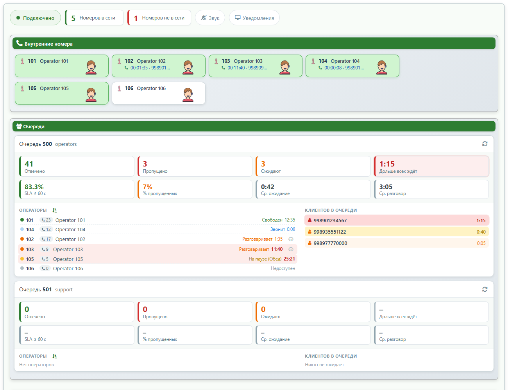
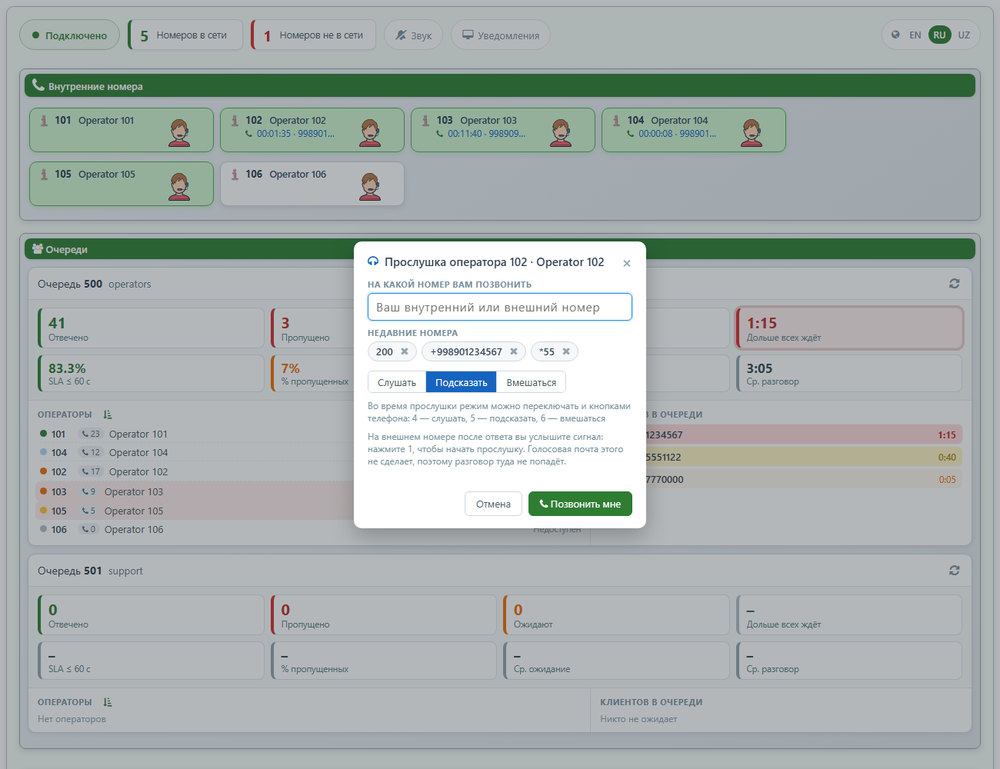
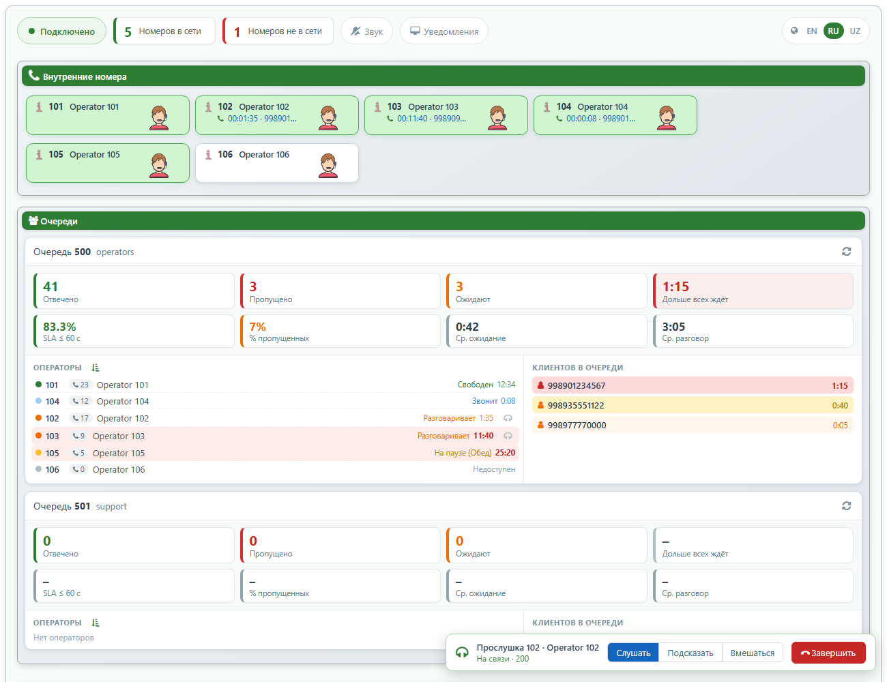

# Issabel Call Monitoring

[English](README.md) | **Русский** | [Oʻzbekcha](README.uz.md)

Панель мониторинга звонков в реальном времени для **Issabel 5**. Заменяет
Operator Panel, который убрали из Issabel 5, и рассчитана на супервизоров
небольших колл-центров. На одной странице видны внутренние номера и их
звонки, очереди с операторами и ожидающими клиентами, показатели очередей,
тревога по долгому ожиданию и прослушка звонков.



## Возможности

- **Внутренние номера**: в сети или нет, текущие звонки с длительностью и
  номером собеседника.
- **Показатели очереди**: отвечено, пропущено, ожидают, дольше всех ждёт,
  уровень обслуживания (SLA), % пропущенных, среднее ожидание и разговор.
  Цвет подсказывает, на что обратить внимание.
- **Операторы**: состояние, число принятых звонков и время в текущем
  состоянии. Список сортируется по состоянию (сначала свободные). Строка
  подсвечивается при долгой паузе или долгом разговоре.
- **Тревога по ожиданию**: ожидающие клиенты подсвечиваются жёлтым, затем
  красным. Во вкладке браузера видно число ожидающих. По желанию включаются
  звуковой сигнал и уведомление на рабочем столе.
- **Прослушка звонков**: слушать разговор оператора, подсказывать ему или
  вмешаться. Asterisk звонит вам на свой внутренний или внешний номер.
- Интерфейс на **английском, русском и узбекском**. Модуль берёт язык из
  настройки Issabel, а кнопки EN / RU / UZ в строке состояния переключают его
  для текущего браузера.

## Требования

- Issabel 5 (на основе FreePBX) и доступ root по SSH.
- Браузер с JavaScript. Для уведомлений на рабочем столе страницу нужно
  открывать по HTTPS.

## Установка

На АТС под root:

```sh
git clone https://github.com/a-abdurazzoq/issabel-call-monitoring.git
cd issabel-call-monitoring
bash install.sh
```

Затем откройте в Issabel **PBX → Мониторинг вызовов** (Call Monitoring).

Установщик копирует модуль в `/var/www/html/modules/control_panel/`, добавляет
пункт меню и назначает владельцем `asterisk:asterisk`. Для прослушки через
внешний номер он также ставит небольшой сценарий для Asterisk
(`/etc/asterisk/extensions_cp_spy.conf`, подключается из
`extensions_custom.conf`) и перезагружает диалплан. По умолчанию пункт меню
видит только группа *administrator*. Другим группам доступ выдаётся в правах
групп Issabel.

### Обновление

```sh
cd issabel-call-monitoring
git pull
bash install.sh
```

Раскладка панелей (какой номер в какой области) хранится в
`/var/www/db/control_panel_design.db`. Установщик этот файл не трогает, поэтому
при обновлении она сохраняется. После обновления перезагрузите страницу через
**Ctrl+F5**, чтобы браузер загрузил новые скрипты.

### Удаление

```sh
rm -rf /var/www/html/modules/control_panel
issabel-menuremove control_panel
rm -f /etc/asterisk/extensions_cp_spy.conf
sed -i '/^#include extensions_cp_spy.conf$/d' /etc/asterisk/extensions_custom.conf
asterisk -rx "dialplan reload"
```

## Как пользоваться

### Строка состояния

| Элемент | Что значит |
| --- | --- |
| Подключено / Подключение… | Успешен ли последний запрос к АТС |
| Номеров в сети / не в сети | Зарегистрированные и незарегистрированные номера |
| Звук | Сигнал, когда клиент ждёт дольше порога тревоги. Браузер разрешает звук только после клика, поэтому включите его этой кнопкой один раз. Выбор запоминается. |
| Уведомления | Уведомление на рабочем столе о долгом ожидании, пока страница в фоне. Есть только при открытии по HTTPS. |
| EN / RU / UZ | Язык модуля для этого браузера (хранится в cookie). Пока язык не выбран, берётся язык Issabel, а если модуль его не знает — английский. |

### Карточка очереди

| Плитка | Что значит | Цвета |
| --- | --- | --- |
| Отвечено / Пропущено | Звонки, принятые операторами / звонки, где клиент положил трубку до ответа | |
| Ожидают | Сколько клиентов в очереди сейчас | |
| Дольше всех ждёт | Время ожидания клиента, который ждёт дольше всех | жёлтый ≥ 30 с, красный ≥ 60 с |
| SLA ≤ N с | Доля звонков, принятых быстрее норматива очереди (*Service Level*) | зелёный ≥ 80 %, жёлтый ≥ 60 %, ниже — красный |
| % пропущенных | Пропущено / (отвечено + пропущено) | зелёный ≤ 5 %, жёлтый ≤ 15 %, выше — красный |
| Ср. ожидание / Ср. разговор | Скользящие средние Asterisk | |

Эти значения берутся из Asterisk (`QueueStatus`). Он считает их с последнего
сброса статистики или перезапуска Asterisk, а не за день. Круговая стрелка в
заголовке карточки сбрасывает статистику этой очереди. Чтобы получать цифры
за день, сбрасывайте статистику всех очередей каждую ночь через cron:

```sh
echo '0 0 * * * root /usr/sbin/asterisk -rx "queue reset stats" >/dev/null 2>&1' \
    > /etc/cron.d/call-monitoring-queue-reset
```

В средних значениях последние звонки весят больше (каждый новый звонок
даёт четверть). Они показывают текущую тенденцию, а не точное среднее за день.

**Операторы.** В строке видно состояние, число принятых звонков и время в
текущем состоянии:

- Разговаривает или звонит: таймер отсчитывается от начала канала телефона
  оператора.
- На паузе или свободен: таймер отсчитывается от последней паузы или
  последнего звонка.

Строка краснеет после 15 минут паузы или 10 минут разговора. Значок рядом с
*Операторы* переключает сортировку по состоянию или по номеру.

### Прослушка звонка



1. Нажмите значок наушников у оператора, который разговаривает.
2. Укажите номер, на который Asterisk позвонит вам. Это может быть ваш
   внутренний или внешний номер, например мобильный. Номера, которые вы уже
   использовали, видны в «Недавних номерах»: клик подставляет номер, × удаляет
   его из списка.
3. Выберите режим и нажмите **Позвонить мне**:
   - **Слушать**: вы слышите оператора и клиента, вас никто не слышит.
   - **Подсказать**: вас слышит только оператор.
   - **Вмешаться**: разговор втроём, вас слышат оба.
4. Возьмите трубку. На внешнем номере вы услышите сигнал: нажмите **1**,
   чтобы начать прослушку. Прослушка заканчивается вместе со звонком
   оператора.

Панель внизу показывает состояние звонка. С неё можно переключить режим и
**завершить** свой звонок, например если указали неверный номер. Кнопки
телефона **4 / 5 / 6** тоже переключают режим. Для переключения с панели нужен
`PlayDTMF` с `Receive` в Asterisk. Если его нет, страница предложит перезвонить
вам в новом режиме.



> **Внешние номера и голосовая почта.** На звонок вместо вас может ответить
> автомат: голосовая почта мобильного оператора или переадресация.
>
> - **Свой внутренний номер:** панель звонит прямо на телефон, без
>   переадресации и голосовой почты, поэтому риска нет.
> - **Внешний номер:** звонок уходит через исходящие маршруты и звонит до
>   20 секунд. После ответа вы услышите сигнал, и прослушка начнётся только
>   когда вы нажмёте **1**. Голосовая почта 1 не нажмёт, поэтому после трёх
>   сигналов звонок завершится и разговор туда не попадёт. Если звонок
>   переадресуют другому человеку, он сможет нажать 1, поэтому на мобильном
>   для прослушки отключите переадресации (`##002#` в большинстве GSM-сетей).
> - Для подтверждения нужен сценарий, который ставит `install.sh`. Без него
>   панель не звонит на внешние номера (свой внутренний работает).

## Настройка

Пороги тревоги — константы в начале разделов файла
`control_panel/themes/default/js/javascript.js`:

| Константа | По умолчанию | Что значит |
| --- | --- | --- |
| `WAIT_WARN_SEC` | 30 | Ожидающий клиент подсвечивается жёлтым |
| `WAIT_ALERT_SEC` | 60 | Красный, звуковой сигнал и уведомление |
| `PAUSE_ALERT_SEC` | 900 | Строка оператора краснеет после такой паузы |
| `TALK_ALERT_SEC` | 600 | Строка оператора краснеет после такого разговора |

Норматив SLA — настройка *Service Level* каждой очереди в конфигурации АТС.

## Безопасность

- Все запросы идут через `index.php` Issabel и требуют входа в Issabel. В
  модуле нет PHP-файлов, которые можно вызвать напрямую.
- Прослушка доступна всем, кто может открыть модуль. Ограничьте доступ к
  пункту меню правами групп Issabel.
- Проверить, переключить или завершить звонок прослушки может только тот
  пользователь, который его начал. Чужие звонки этими запросами не сбросить.
- Действия, которые что-то меняют (сбросить или начать звонок, прослушка,
  сохранение раскладки, сброс статистики), принимаются только как POST-запросы
  со страницы самого модуля. Ссылка или форма на чужом сайте не сможет
  выполнить их от имени вошедшего пользователя (защита от CSRF).
- В ранних версиях модуля (upstream) был `libs/utilities.php`. Его можно было
  вызвать без входа, и он передавал параметр запроса в `shell_exec()`, что
  позволяло выполнять команды на сервере. Файл удалён. Установщик полностью
  заменяет каталог модуля, поэтому при обновлении файл исчезает.

## Если что-то не работает

- **Ничего не обновляется, висит «Подключение…»:** откройте инструменты
  разработчика в браузере и посмотрите запросы `action=pbxSnapshot`. Они должны
  идти примерно раз в секунду. Ответ с ошибкой называет причину, например
  нет подключения к Asterisk Manager.
- **После обновления старый вид или ошибки:** перезагрузите страницу через
  Ctrl+F5.
- **Нет кнопки «Уведомления»:** страница открыта по HTTP. Уведомлениям нужен
  HTTPS.
- **Прослушка не начинается:** запустите на АТС `asterisk -rvvv`, нажмите
  «Позвонить мне» и посмотрите вывод.

## Разработка

Архитектура, путь запросов и порядок добавления строк и эндпоинтов описаны в
[docs/DEVELOPMENT.md](docs/DEVELOPMENT.md) (на английском).

## Авторы и лицензия

- Основан на модуле Operator Panel (`control_panel`) Issabel от PaloSanto
  Solutions.
- Адаптирован для Issabel 5 Хамедом Кухфаллахом (VoipIran.io) в
  [voipiran/voiz-issabel-monitoring](https://github.com/voipiran/voiz-issabel-monitoring).
- Распространяется по лицензии GNU General Public License v2, см.
  [LICENSE](LICENSE).
