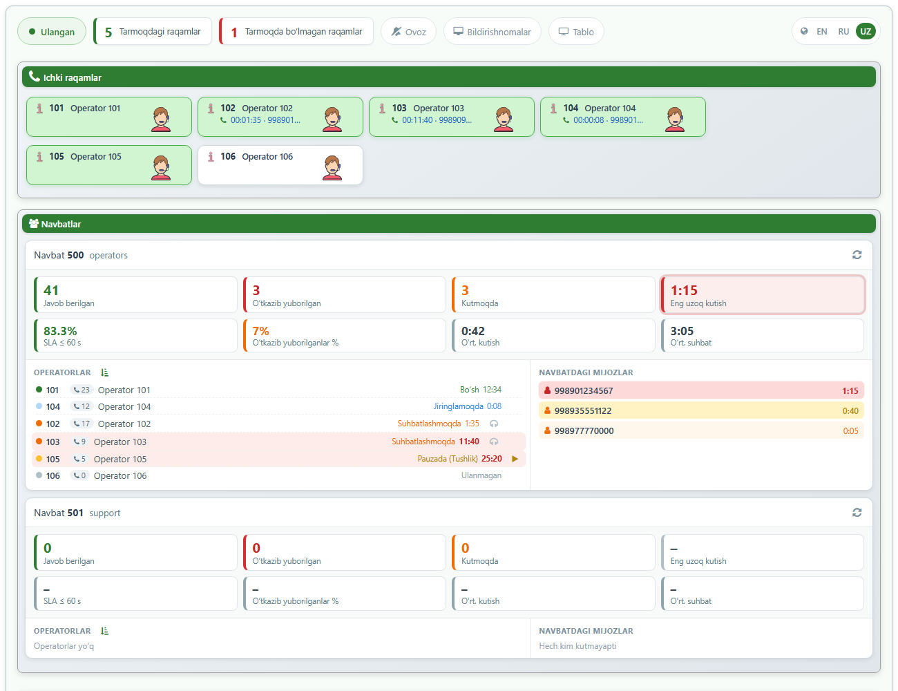
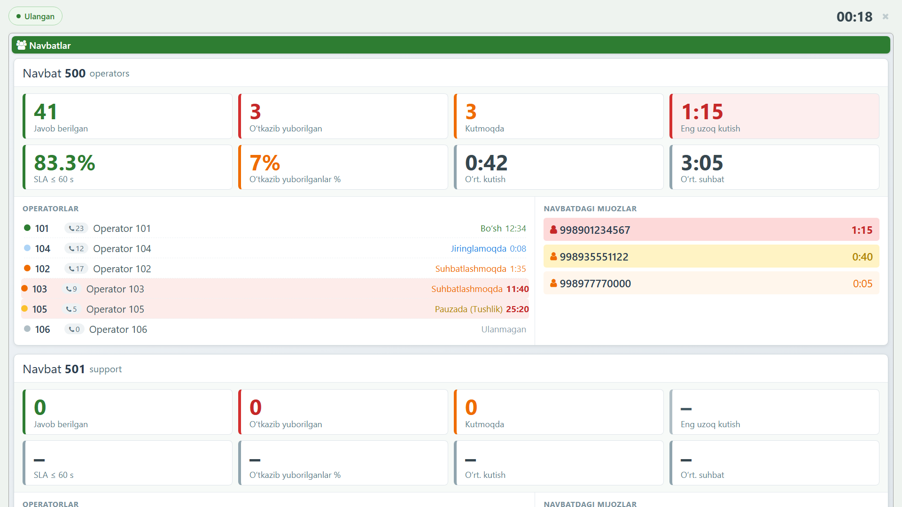
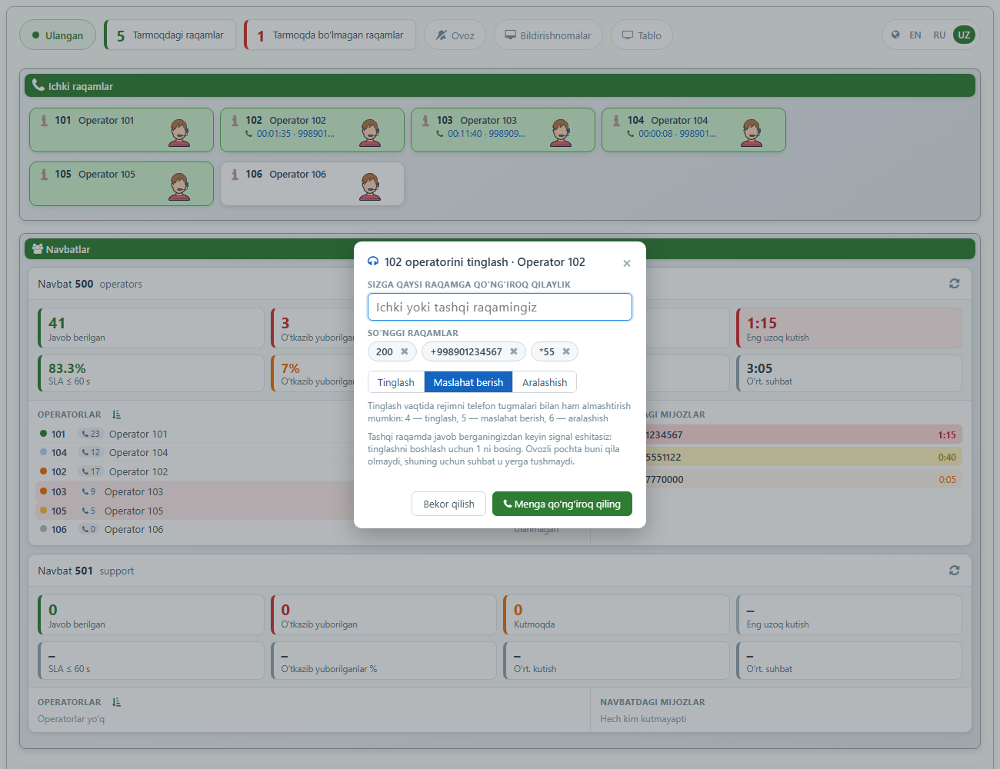
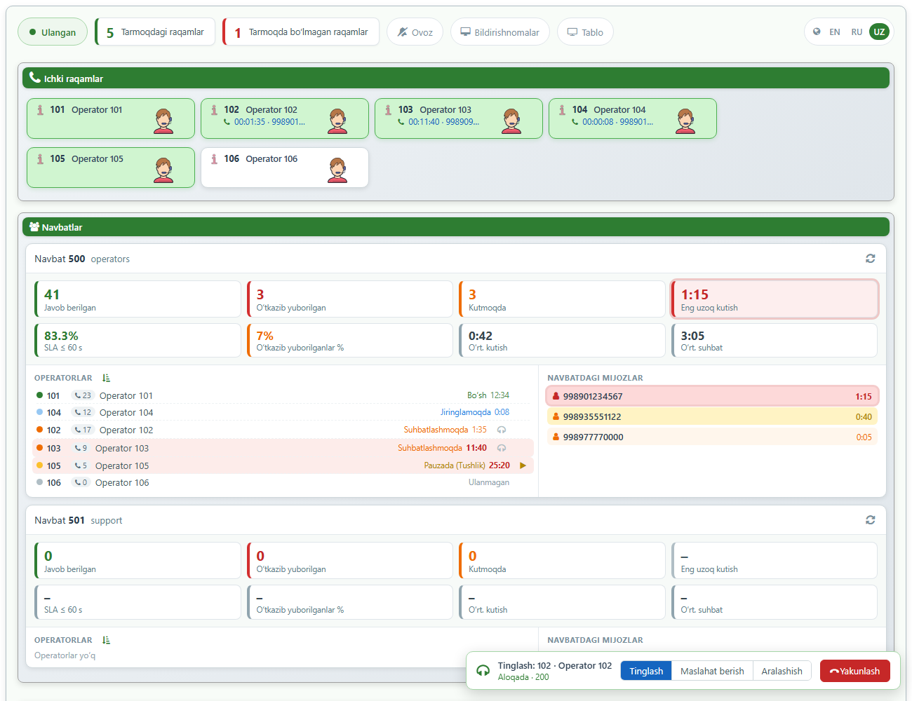

# Issabel Call Monitoring

[English](README.md) | [Русский](README.ru.md) | **Oʻzbekcha**

**Issabel 5** uchun qoʻngʻiroqlarni real vaqtda kuzatish paneli. U Issabel 5
dan olib tashlangan Operator Panel oʻrnini bosadi va kichik call-markazlar
supervayzerlari uchun moʻljallangan. Bitta sahifada ichki raqamlar va ularning
qoʻngʻiroqlari, operatorlar va kutayotgan mijozlar bilan navbatlar, navbat
koʻrsatkichlari, uzoq kutish signali va qoʻngʻiroqlarni tinglash koʻrinadi.



## Imkoniyatlar

- **Ichki raqamlar**: tarmoqda yoki yoʻqligi, joriy qoʻngʻiroqlar, ularning
  davomiyligi va suhbatdosh raqami.
- **Navbat koʻrsatkichlari**: javob berilgan, oʻtkazib yuborilgan, kutayotgan
  qoʻngʻiroqlar, eng uzoq kutish, xizmat koʻrsatish darajasi (SLA),
  oʻtkazib yuborilganlar ulushi, oʻrtacha kutish va suhbat vaqti. Rang
  qaysi qiymatga eʼtibor berish kerakligini koʻrsatadi.
- **Operatorlar**: holati, qabul qilgan qoʻngʻiroqlari soni va joriy holatda
  qancha vaqt turgani. Roʻyxat holat boʻyicha saralanadi (avval boʻshlar).
  Uzoq pauza yoki uzoq suhbatda qator qizil rangga kiradi. Supervayzer
  operatorni roʻyxatning oʻzidan pauzaga qoʻyishi yoki pauzadan chiqarishi
  mumkin.
- **Uzoq kutish signali**: kutayotgan mijozlar avval sariq, keyin qizil
  rangda belgilanadi. Brauzer vkladkasida kutayotganlar soni koʻrinadi.
  Xohishga koʻra ovozli signal va ish stolidagi bildirishnoma yoqiladi.
- **Tablo rejimi**: operatorlar zalidagi televizor uchun toʻliq ekran
  koʻrinishi: faqat navbatlar, yirik raqamlar, tugmalarsiz.
- **Qoʻngʻiroqni tinglash**: operator suhbatini tinglash, unga maslahat berish
  yoki suhbatga aralashish. Asterisk sizning ichki yoki tashqi raqamingizga
  qoʻngʻiroq qiladi.
- **Ingliz, rus va oʻzbek** tillaridagi interfeys. Modul Issabel til
  sozlamasidan foydalanadi, holat qatoridagi EN / RU / UZ tugmalari esa tilni
  joriy brauzer uchun almashtiradi.

## Talablar

- Issabel 5 (FreePBX asosida) va SSH orqali root huquqi.
- JavaScript yoqilgan brauzer. Ish stolidagi bildirishnomalar uchun sahifa
  HTTPS orqali ochilishi kerak.

## Oʻrnatish

ATSda root sifatida:

```sh
git clone https://github.com/a-abdurazzoq/issabel-call-monitoring.git
cd issabel-call-monitoring
bash install.sh
```

Soʻng Issabelda **PBX → Call Monitoring** boʻlimini oching.

Oʻrnatuvchi modulni `/var/www/html/modules/control_panel/` ga koʻchiradi,
menyu bandini qoʻshadi va egasini `asterisk:asterisk` qilib belgilaydi.
Tashqi raqam orqali tinglash uchun u Asteriskka kichik ssenariy ham oʻrnatadi
(`/etc/asterisk/extensions_cp_spy.conf`, `extensions_custom.conf` dan
ulanadi) va dialplanni qayta yuklaydi.
Standart holatda menyu bandini faqat *administrator* guruhi koʻradi. Boshqa
guruhlarga ruxsat Issabel guruh huquqlarida beriladi.

### Yangilash

```sh
cd issabel-call-monitoring
git pull
bash install.sh
```

Panellar joylashuvi (qaysi raqam qaysi hududda koʻrsatilishi)
`/var/www/db/control_panel_design.db` faylida saqlanadi. Oʻrnatuvchi bu faylga
tegmaydi, shuning uchun yangilashda u saqlanib qoladi. Yangilagandan keyin
brauzer yangi skriptlarni yuklashi uchun sahifani **Ctrl+F5** bilan qayta
yuklang.

### Oʻchirish

```sh
rm -rf /var/www/html/modules/control_panel
issabel-menuremove control_panel
rm -f /etc/asterisk/extensions_cp_spy.conf
sed -i '/^#include extensions_cp_spy.conf$/d' /etc/asterisk/extensions_custom.conf
asterisk -rx "dialplan reload"
```

## Foydalanish

### Holat qatori

| Element | Maʼnosi |
| --- | --- |
| Ulangan / Ulanmoqda… | ATSga oxirgi soʻrov muvaffaqiyatli boʻldimi |
| Tarmoqdagi / Tarmoqda boʻlmagan raqamlar | Roʻyxatdan oʻtgan va oʻtmagan ichki raqamlar |
| Ovoz | Mijoz signal chegarasidan uzoqroq kutganda ovozli signal. Brauzer ovozga faqat bosishdan keyin ruxsat beradi, shuning uchun uni shu tugma bilan bir marta yoqing. Tanlov eslab qolinadi. |
| Bildirishnomalar | Sahifa fonda boʻlganda uzoq kutish haqida ish stolida bildirishnoma. Faqat HTTPS orqali ochilganda bor. |
| Tablo | Televizor uchun toʻliq ekran koʻrinishi, qarang: [Tablo rejimi](#tablo-rejimi). |
| EN / RU / UZ | Ushbu brauzer uchun modul tili (cookieda saqlanadi). Til tanlanmagan boʻlsa, Issabel tili, modulda u til boʻlmasa ingliz tili ishlatiladi. |

### Navbat kartasi

| Plitka | Maʼnosi | Ranglar |
| --- | --- | --- |
| Javob berilgan / Oʻtkazib yuborilgan | Operatorlar qabul qilgan qoʻngʻiroqlar / mijoz javobni kutmasdan goʻshakni qoʻygan qoʻngʻiroqlar | |
| Kutmoqda | Hozir navbatda nechta mijoz bor | |
| Eng uzoq kutish | Eng uzoq kutayotgan mijozning kutish vaqti | sariq ≥ 30 s, qizil ≥ 60 s |
| SLA ≤ N s | Navbatning *Service Level* vaqti ichida javob berilgan qoʻngʻiroqlar ulushi | yashil ≥ 80 %, sariq ≥ 60 %, undan past qizil |
| Oʻtkazib yuborilganlar % | Oʻtkazib yuborilgan / (javob berilgan + oʻtkazib yuborilgan) | yashil ≤ 5 %, sariq ≤ 15 %, undan yuqori qizil |
| Oʻrt. kutish / Oʻrt. suhbat | Asteriskning sirpanuvchi oʻrtacha qiymatlari | |

Bu qiymatlar Asteriskdan (`QueueStatus`) olinadi. Asterisk ularni kun
boʻyicha emas, statistika oxirgi marta tozalangandan yoki Asterisk qayta ishga
tushirilgandan beri hisoblaydi. Karta sarlavhasidagi aylana strelka shu
navbat statistikasini tozalaydi. Kunlik raqamlarni olish uchun har kecha cron
orqali barcha navbatlar statistikasini tozalang:

```sh
echo '0 0 * * * root /usr/sbin/asterisk -rx "queue reset stats" >/dev/null 2>&1' \
    > /etc/cron.d/call-monitoring-queue-reset
```

Oʻrtacha qiymatlarda oxirgi qoʻngʻiroqlar kattaroq vaznga ega (har bir yangi
qoʻngʻiroq chorak ulush beradi). Ular kunlik aniq oʻrtachani emas, joriy
tendensiyani koʻrsatadi.

**Operatorlar.** Qatorda holat, qabul qilingan qoʻngʻiroqlar soni va joriy
holatdagi vaqt koʻrinadi:

- Suhbatlashmoqda yoki jiringlamoqda: taymer operator telefoni kanali
  boshlangan paytdan hisoblanadi.
- Pauzada yoki boʻsh: taymer oxirgi pauza yoki oxirgi qoʻngʻiroqdan
  hisoblanadi.

15 daqiqalik pauza yoki 10 daqiqalik suhbatdan keyin qator qizil rangga
kiradi. *Operatorlar* yonidagi belgi holat yoki raqam boʻyicha saralashni
almashtiradi.

**Operatorni pauzaga qoʻyish.** Kursorni operator qatoriga olib boring va
uning oxiridagi pauza belgisini bosing; pauzadagi operatorda «▶» belgisi
doim koʻrinadi. Tasdiqlagandan keyin operator oʻzining **barcha**
navbatlarida pauzaga qoʻyiladi (yoki pauzadan chiqariladi), xuddi uning
telefonidagi pauza tugmasi kabi. Pauza sababi — «Supervayzer», shuning uchun
qatorda pauzani kim qoʻyganini koʻrish mumkin.

### Tablo rejimi



Holat qatoridagi **Tablo** tugmasi butun ekranda faqat navbatlarni
koʻrsatadi: yirik raqamlar, tugmalarsiz. Oʻng yuqori burchakda soat va
chiqish uchun × (yoki Esc tugmasi).

Operatorlar zalidagi televizor uchun televizor brauzerida Issabelga kiring va
modulni manzilga `&wallboard=1` qoʻshib oching, masalan
`https://pbx/index.php?menu=control_panel&wallboard=1`. Sahifa darhol tablo
rejimida ochiladi; toʻliq ekran uchun F11 ni bosing. Sahifa ochiq turganda
Issabel sessiyasi tugamaydi.

### Qoʻngʻiroqni tinglash



1. Suhbatlashayotgan operator yonidagi quloqchin belgisini bosing.
2. Asterisk sizga qoʻngʻiroq qiladigan raqamni kiriting. Bu ichki yoki tashqi
   raqamingiz, masalan mobil raqam boʻlishi mumkin. Avval foydalangan
   raqamlaringiz *Soʻnggi raqamlar* ostida koʻrinadi: raqamni bosish uni
   tanlaydi, × esa roʻyxatdan oʻchiradi.
3. Rejimni tanlang va **Menga qoʻngʻiroq qiling** tugmasini bosing:
   - **Tinglash**: siz operator va mijozni eshitasiz, sizni hech kim
     eshitmaydi.
   - **Maslahat berish**: sizni faqat operator eshitadi.
   - **Aralashish**: uch kishilik suhbat, sizni ikkalasi ham eshitadi.
4. Qoʻngʻiroqqa javob bering. Tashqi raqamda signal eshitasiz: tinglashni
   boshlash uchun **1** ni bosing. Operator qoʻngʻirogʻi tugashi bilan
   tinglash ham tugaydi.

Pastdagi panel qoʻngʻiroq holatini koʻrsatadi. Undan rejimni almashtirish va
oʻz qoʻngʻirogʻingizni **yakunlash** mumkin, masalan notoʻgʻri raqam
kiritgan boʻlsangiz. Telefonning **4 / 5 / 6** tugmalari ham rejimni
almashtiradi. Paneldan almashtirish uchun Asteriskda `Receive` parametrli
`PlayDTMF` kerak. Agar u boʻlmasa, sahifa sizga yangi rejimda qayta qoʻngʻiroq
qilishni taklif qiladi.



> **Tashqi raqamlar va ovozli pochta.** Qoʻngʻiroqqa siz emas, avtomat javob
> berishi mumkin: mobil operatorning ovozli pochtasi yoki yoʻnaltirish.
>
> - **Oʻz ichki raqamingiz:** panel toʻgʻridan-toʻgʻri telefoningizga,
>   yoʻnaltirish va ovozli pochtasiz qoʻngʻiroq qiladi, shuning uchun xavf
>   yoʻq.
> - **Tashqi raqam:** qoʻngʻiroq chiquvchi marshrutlar orqali ketadi va
>   20 soniyagacha jiringlaydi. Javob berganingizdan keyin signal eshitasiz,
>   tinglash esa faqat **1** ni bosganingizda boshlanadi. Ovozli pochta 1 ni
>   bosmaydi, shuning uchun uchta signaldan keyin qoʻngʻiroq yakunlanadi va
>   suhbat u yerga tushmaydi. Qoʻngʻiroq boshqa odamga yoʻnaltirilsa, u 1 ni
>   bosishi mumkin, shuning uchun tinglash uchun ishlatiladigan mobil
>   telefonda yoʻnaltirishlarni oʻchiring (koʻpchilik GSM tarmoqlarida
>   `##002#`).
> - Tasdiqlash uchun `install.sh` oʻrnatadigan ssenariy kerak. Usiz panel
>   tashqi raqamlarga qoʻngʻiroq qilmaydi (oʻz ichki raqamingiz ishlaydi).

## Sozlash

Signal chegaralari
`control_panel/themes/default/js/javascript.js` faylidagi boʻlimlar boshida
konstanta sifatida berilgan:

| Konstanta | Standart | Maʼnosi |
| --- | --- | --- |
| `WAIT_WARN_SEC` | 30 | Kutayotgan mijoz sariq rangga kiradi |
| `WAIT_ALERT_SEC` | 60 | Qizil rang, ovozli signal va bildirishnoma |
| `PAUSE_ALERT_SEC` | 900 | Shunday pauzadan keyin operator qatori qizil boʻladi |
| `TALK_ALERT_SEC` | 600 | Shunday suhbatdan keyin operator qatori qizil boʻladi |

SLA vaqti ATS konfiguratsiyasida har bir navbatning *Service Level*
sozlamasidir.

## Xavfsizlik

- Barcha soʻrovlar Issabelning `index.php` fayli orqali oʻtadi va Issabelga
  kirishni talab qiladi. Modulda toʻgʻridan-toʻgʻri chaqirib boʻladigan PHP
  fayllar yoʻq.
- Tinglash modulni ocha oladigan har bir foydalanuvchiga ochiq. Menyu bandiga
  kirishni Issabel guruh huquqlari bilan cheklang.
- Tinglash qoʻngʻirogʻini faqat uni boshlagan foydalanuvchi tekshirishi,
  almashtirishi yoki yakunlashi mumkin. Bu soʻrovlar orqali boshqa
  qoʻngʻiroqlarni uzib boʻlmaydi.
- Biror narsani oʻzgartiradigan amallar (qoʻngʻiroqni uzish yoki boshlash,
  tinglash, operatorni pauzaga qoʻyish, joylashuvni saqlash, statistikani
  tozalash) faqat modulning oʻz
  sahifasidan yuborilgan POST soʻrovlar sifatida qabul qilinadi. Boshqa
  saytdagi havola yoki forma ularni tizimga kirgan foydalanuvchi nomidan
  bajara olmaydi (CSRF himoyasi).
- Modulning avvalgi versiyalarida (upstream) `libs/utilities.php` bor edi. Uni
  tizimga kirmasdan chaqirish mumkin edi va u soʻrov parametrini
  `shell_exec()` ga uzatardi, bu esa serverda buyruqlarni bajarishga imkon
  berardi. Fayl oʻchirildi. Oʻrnatuvchi modul katalogini toʻliq almashtiradi,
  shuning uchun yangilashda bu fayl yoʻqoladi.

## Muammolarni hal qilish

- **Hech narsa yangilanmaydi, «Ulanmoqda…» turib qoladi:** brauzerda
  dasturchi vositalarini oching va `action=pbxSnapshot` soʻrovlariga qarang.
  Ular taxminan har soniyada kelishi kerak. Xato javobida sabab koʻrsatiladi,
  masalan Asterisk Managerga ulanib boʻlmagani.
- **Yangilashdan keyin eski koʻrinish yoki xatolar:** sahifani Ctrl+F5 bilan
  qayta yuklang.
- **«Bildirishnomalar» tugmasi yoʻq:** sahifa HTTP orqali ochilgan.
  Bildirishnomalar uchun HTTPS kerak.
- **Tinglash boshlanmayapti:** ATSda `asterisk -rvvv` ni ishga tushiring,
  «Menga qoʻngʻiroq qiling» tugmasini bosing va chiqishni koʻring.

## Ishlab chiqish

Arxitektura, soʻrovlar yoʻli hamda matnlar va endpointlarni qoʻshish tartibi
[docs/DEVELOPMENT.md](docs/DEVELOPMENT.md) faylida (ingliz tilida) yozilgan.

## Mualliflar va litsenziya

- PaloSanto Solutions tomonidan ishlab chiqilgan Issabelning Operator Panel
  (`control_panel`) moduli asosida.
- Issabel 5 uchun Hamed Koohfallah (VoipIran.io) tomonidan
  [voipiran/voiz-issabel-monitoring](https://github.com/voipiran/voiz-issabel-monitoring)
  loyihasida moslashtirilgan.
- GNU General Public License v2 litsenziyasi asosida tarqatiladi, qarang:
  [LICENSE](LICENSE).
